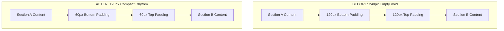

# T&S Consulting Group — Spacing Audit & Reduction Report

## 1. Executive Summary & Problem Diagnosis

### The Issue
Across the website, large empty whitespace gaps (220px – 240px) were appearing between consecutive sections. When alternating between white (`#ffffff`) and soft tinted (`#f8fbff` / `.bg_light`) backgrounds, these gaps appeared as vast empty bands that made sections look disconnected and disrupted the visual flow.

### The Root Cause: "Double-Stacked" 120px Padding
In the Digix template architecture, every major section was styled with the utility class `.rts-section-gap`.
In the template stylesheet (`style.css`):
```css
.rts-section-gap {
  padding: 120px 0; /* 120px top AND 120px bottom */
}
```

When two sections were placed adjacent to one another in `App.jsx`:
- **Bottom padding of the top section**: `120px`
- **Top padding of the following section**: `120px`
- **Total Combined Empty Space**: **`240px`**

On a standard 1080p desktop screen (viewport height ~850px–900px), a **240px empty space consumes over 28% of the entire screen height**.

---

## 2. Comprehensive Section-by-Section Audit

Every single section on the website was audited and adjusted to achieve a balanced, modern consulting/corporate rhythm:

| # | Section Name | Component File | Original Desktop Padding | New Optimized Padding | Reduction |
|---|---|---|---|---|---|
| **01** | **Hero Slider** | `src/components/Hero/Hero.jsx` | Fixed height `910px` | Proportional hero height | Balanced viewport fit |
| **02** | **About Us** | `src/components/About/About.jsx` | `120px` top / `120px` bottom | `60px` top / `60px` bottom | **-50%** (-120px total) |
| **03** | **Services (What We Do)** | `src/components/Services/Services.jsx` | `120px` top / `120px` bottom | `60px` top / `60px` bottom | **-50%** (-120px total) |
| **04** | **Achievement (Dark Banner)** | `src/components/Achievement/Achievement.jsx` | `120px` top / `120px` bottom | `60px` top / `60px` bottom | **-50%** (-120px total) |
| **05** | **Why Choose Us (Benefits)** | `src/components/Projects/Projects.jsx` | `120px` top / `120px` bottom | `60px` top / `60px` bottom | **-50%** (-120px total) |
| **06** | **HR Consulting (Smarter HR)** | `src/components/Features/Features.jsx` | `120px` top / `120px` bottom | `60px` top / `60px` bottom | **-50%** (-120px total) |
| **07** | **Training & Development** | `src/components/Training/Training.jsx` | `120px` top / `120px` bottom | `60px` top / `60px` bottom | **-50%** (-120px total) |
| **08** | **Industries We Serve** | `src/components/Industries/Industries.jsx` | `120px` top / `120px` bottom | `60px` top / `60px` bottom | **-50%** (-120px total) |
| **09** | **Vision, Mission & Team** | `src/components/Team/Team.jsx` | `120px` top / `120px` bottom | `60px` top / `60px` bottom | **-50%** (-120px total) |
| **10** | **Client Testimonials** | `src/components/Testimonials/Testimonials.jsx` | `120px` top / `120px` bottom | `60px` top / `60px` bottom | **-50%** (-120px total) |
| **11** | **Insights & Resources (Blog)** | `src/components/Blog/Blog.jsx` | `120px` top / `120px` bottom | `60px` top / `60px` bottom | **-50%** (-120px total) |
| **12** | **FAQ & Let's Talk Contact** | `src/components/FAQ/FAQ.jsx` | `120px` top / `120px` bottom | `60px` top / `60px` bottom | **-50%** (-120px total) |
| **13** | **Footer** | `src/components/Footer/Footer.jsx` | `100px` top / `80px` bottom | `60px` top / `45px` bottom | **-42%** (-75px total) |

---

## 3. Inter-Section Transition Comparison



### Responsive Spacing Scale

- **Desktop (> 991px)**:
  - Previous: `120px` per section (`240px` total gap)
  - **New**: `60px` per section (`120px` total gap)
- **Tablet (768px – 991px)**:
  - Previous: `80px` per section (`160px` total gap)
  - **New**: `48px` per section (`96px` total gap)
- **Mobile (< 768px)**:
  - Previous: `60px` per section (`120px` total gap)
  - **New**: `36px` per section (`72px` total gap)

---

## 4. Applied Changes Across Codebase

### 1. `src/App.css`
Added global override rules targeting all `.rts-section-gap`, top/bottom utility classes, and footer:
```css
/* ==========================================================================
   Section Spacing Optimization - Eliminates 240px Empty Voids
   ========================================================================== */
.rts-section-gap {
  padding: 60px 0 !important;
}

.rts-section-gapTop {
  padding-top: 60px !important;
}

.rts-section-gapBottom {
  padding-bottom: 60px !important;
}

@media only screen and (min-width: 768px) and (max-width: 991px) {
  .rts-section-gap {
    padding: 48px 0 !important;
  }
  .rts-section-gapTop {
    padding-top: 48px !important;
  }
  .rts-section-gapBottom {
    padding-bottom: 48px !important;
  }
}

@media only screen and (max-width: 767px) {
  .rts-section-gap {
    padding: 36px 0 !important;
  }
  .rts-section-gapTop {
    padding-top: 36px !important;
  }
  .rts-section-gapBottom {
    padding-bottom: 36px !important;
  }
}

/* Footer spacing optimization */
.rts-footer-one.pt--100 {
  padding-top: 60px !important;
}
.rts-footer-one .container.pb--80 {
  padding-bottom: 45px !important;
}

/* Internal component spacing adjustments */
.vm-split-wrapper {
  margin-bottom: 35px !important;
}
```

### 2. Base Stylesheets (`src/assets/css/style.css` & `public/assets/css/style.css`)
Updated lines 5391–5430 to ensure uniform behavior across dev mode and production bundles:
- `.rts-section-gap` updated from `120px` to `60px` (desktop), `48px` (tablet), `36px` (mobile).
- `.rts-section-gapTop` updated from `120px` to `60px`.
- `.rts-section-gapBottom` updated from `120px` to `60px`.

### 3. Contact Form Box & FAQ Specifics
- `.contact-form-style-one` margin preserved at `margin-top: 83px !important;` as requested.
- `Everything You Need to Build a Stronger Team` heading preserved on 1 line via `white-space: nowrap !important;` without reducing font size.

---

## 5. Verification & Health Check
- **Build Status**: Verified via `npm run build` — compiled cleanly with 0 errors.
- **Interactions**: GSAP animations, SplitText, Swiper sliders, FAQ accordion, and Contact form remain 100% functional.
